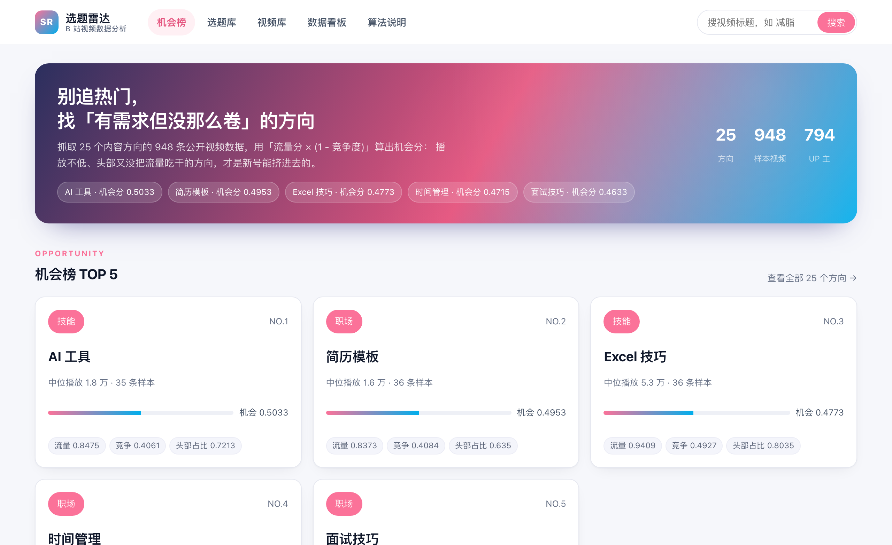
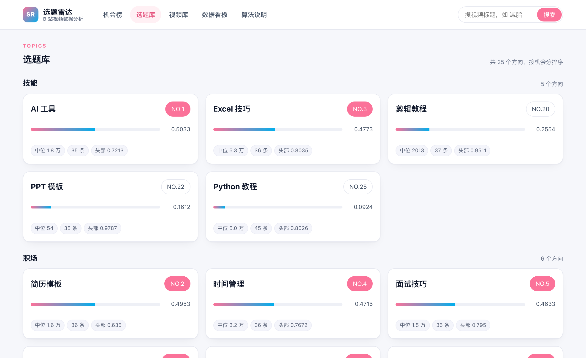
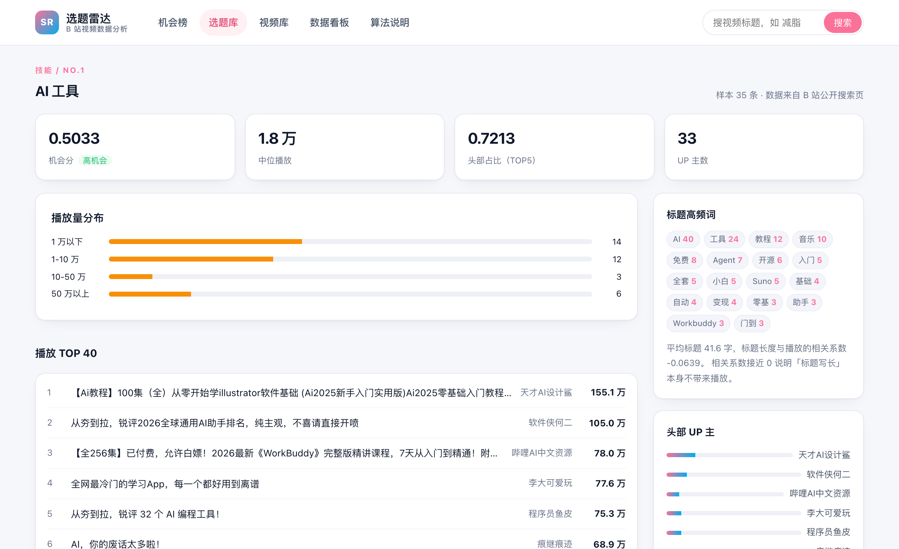
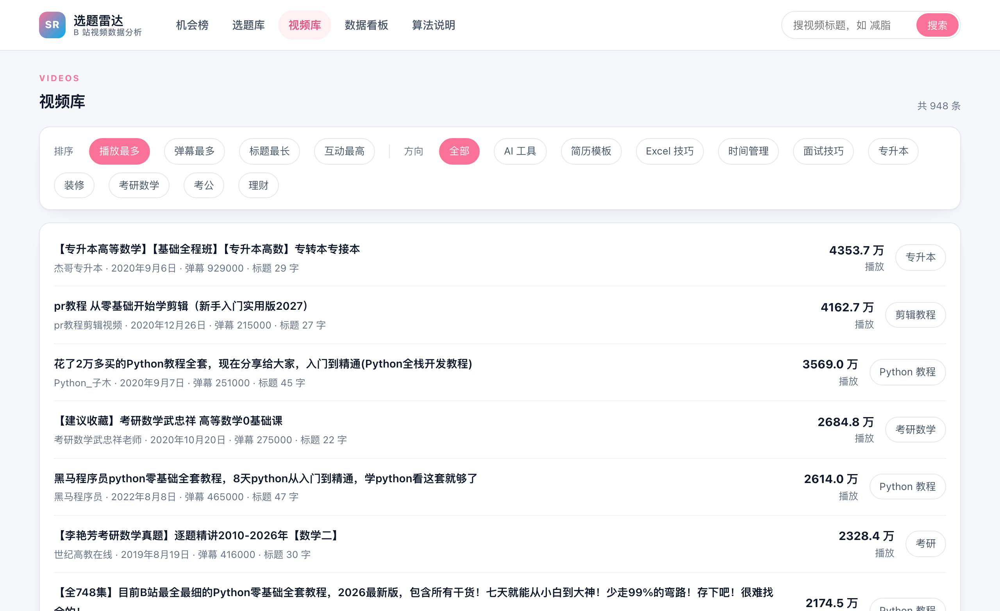
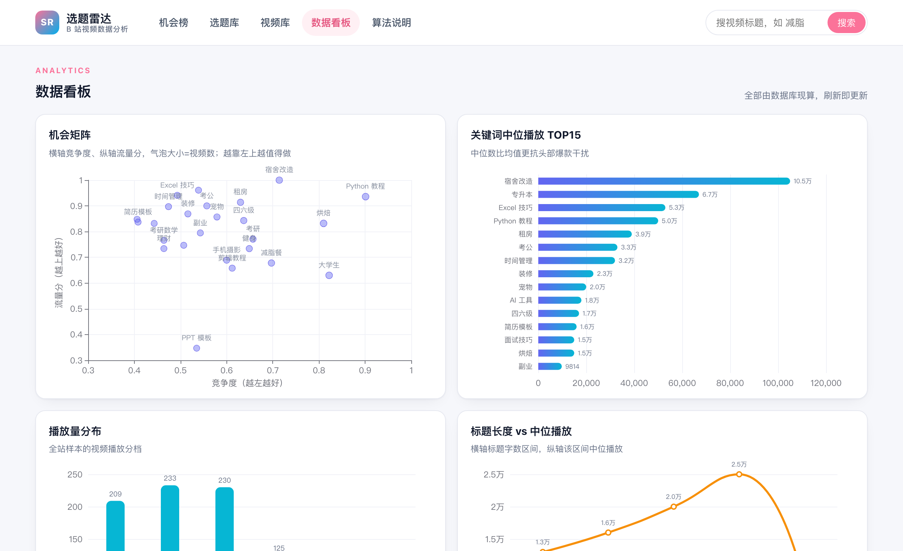
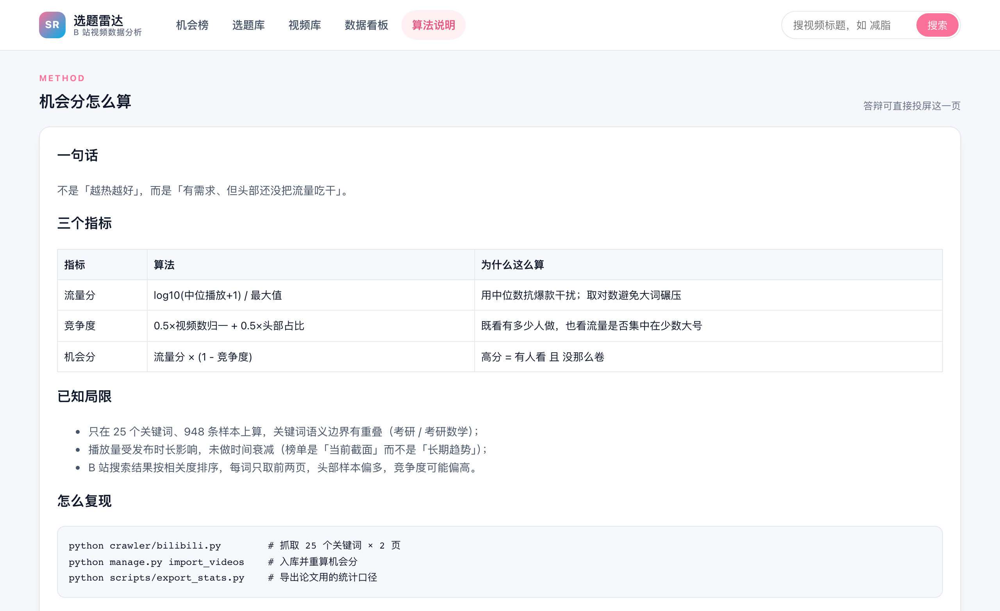

# 037 基于 Django 的 B 站视频数据分析与选题推荐系统-设计展示

> **代码有偿获取 可接受定制 微信联系方式: csbysj2020 或 ACE2487，备注(BS)**

> **完整源码与全套文档 · 在线自助获取 >>> [https://mbd.pub/o/bread/YZaWl5lwbA==](https://mbd.pub/o/bread/YZaWl5lwbA==)**

> **成品页（功能介绍 / 更多选题）>>> [https://bishe.suilang.net/products/bili-topic-radar](https://bishe.suilang.net/products/bili-topic-radar)**

> 

> 

## 视频

> **点击查看 >>> [https://www.bilibili.com/video/BV1pusF6eEgt/](https://www.bilibili.com/video/BV1pusF6eEgt/)**

## 项目简介

把「该拍什么」拆成需求与竞争两个可计算的维度：抓 25 个内容方向、948 条公开视频、794 位 UP 主，用「流量分 ×（1 − 竞争度）」算出机会分。三个真实结论都写进论文：播放量长尾（均值 66 万 vs 中位 1.5 万）、标题长度与播放相关系数仅 0.10、TOP10 UP 吃掉 46.7% 播放。

内容创作者面临的核心问题已经从「怎么拍」变成「拍什么」。

常见选题工具只回答「什么最热」，但热门方向往往被头部账号占据。

本项目设计并实现了一个面向内容选题的分析系统：采集 25 个内容方向的 948 条公开视频数据（794 位 UP 主，总播放 6.26 亿），从「需求」与「竞争」两个维度构建指标，用「流量分 ×（1 − 竞争度）」合成机会分，并对结果做敏感性分析。

本仓库为**设计展示**：包含项目说明、技术架构、实验结果与运行截图；完整源码、任务书、开题报告、毕业论文与使用说明可通过上方链接自助获取，成品页可查看更多选题，也可联系微信咨询定制。

## 功能特性

1. 真实数据：25 个关键词 / 948 条视频 / 794 位 UP 主 / 6.26 亿播放，采集器只抓公开搜索页

2. 机会分模型：流量分（对数归一中位播放）×（1 − 竞争度），竞争度由视频数与 TOP5 头部占比合成

3. 机会榜：TOP5 方向带三项分解（流量 / 竞争 / 头部占比），点进去看该方向全部数据

4. 关键词详情：播放分布、TOP40 视频榜、标题高频词（二元组切分）、头部 UP 占比

5. 视频库：按标题搜索、按方向筛选、四种排序、分页，可直接跳 B 站原视频

6. 数据看板六图：机会矩阵散点、中位播放榜、播放分布、标题长度 vs 播放、方向分布、机会分均值

7. 算法说明页：指标定义、已知局限、复现命令全写在一页，答辩可投屏

8. 三个可复核的结论：长尾结构（均值/中位 = 44 倍）、标题长度弱相关（r=0.10）、头部集中（46.7%）

9. 敏感性分析：流量权重 0.5/1/2 三档下 Top5 排名稳定，中段互换

10. 采集→入库→指标重算全脚本化：crawler/bilibili.py + import_videos + export_stats

## 技术架构

| 项目 | 说明 |
| --- | --- |
| 编程语言 | Python 3.8 及以上 |
| Web 框架 | Django 4.2（默认 SQLite，免装数据库） |
| 采集 | requests + BeautifulSoup4（B 站搜索页 SSR） |
| 前端 | 原生 HTML/CSS/JS + ECharts 5.4（本地引入） |
| 样本规模 | 25 个方向 / 948 条视频 / 794 UP 主 |
| 核心指标 | 机会分 = 流量分 ×（1 − 竞争度） |
| 运行端口 | http://127.0.0.1:8000 |
| 后台账号 | 自建 superuser（createsuperuser） |

## 目录结构

以下为完整交付版的结构（本仓库仅作设计展示）：

```
bili-topic-radar/
└── （目录树待补）
```

## 数据与实验结论

- 系统基于 Django 4.2 与 SQLite 实现，提供机会榜、选题库、关键词详情、视频库、数据看板与算法说明六个模块，图表由 ECharts 渲染，数据全部由数据库现算。
- 数据分析给出三个结论：其一，播放量呈典型长尾分布，平均 660,121 而中位数仅 15,000，均值被少量爆款拉高；其二，标题长度与播放量的相关系数仅 0.1048，说明「把标题写长」本身并不带来播放；其三，TOP10 UP 主占据全部样本播放的 46.67%，头部集中度极高，这也是「追热门」策略对新号无效的量化解释。
- 真实数据：25 个关键词 / 948 条视频 / 794 位 UP 主 / 6.26 亿播放，采集器只抓公开搜索页
- 机会分模型：流量分（对数归一中位播放）×（1 − 竞争度），竞争度由视频数与 TOP5 头部占比合成

## 交付内容

1. 完整源码（采集器 + Django 工程 + analysis.py 指标模块 + scripts）
2. 抓好的真实数据（data/raw_videos.json，948 条视频）
3. 指标导出与绘图脚本（stats.json / 论文四张配图）
4. 毕业设计任务书（Word）、开题报告（Word）
5. 毕业论文（Word，七章制，含 4 张图表）
6. 系统使用与二次开发说明（Word + md，12 节）
7. 6 张界面截图、4 张论文配图

## 常见问题

**数据是爬的吗？能更新吗？**

是抓的。crawler/bilibili.py 请求 B 站搜索页（服务端渲染的公开 HTML），25 个关键词两页约 2 分钟；重跑采集 + import_videos 即可更新，按 BV 号去重。

**为什么不直接调 B 站 API？**

搜索接口需要 wbi 签名，未登录高频请求会被拦；SSR 页面把视频卡片直接写在 HTML 里，是更稳的路径。

**机会分是怎么算的？**

流量分 = log10(中位播放+1) 归一到最大值；竞争度 = 0.5×视频数归一 + 0.5×TOP5 播放占比；机会分 = 流量分 ×（1 − 竞争度）。权重都在 analysis.py 一处，改完重跑 import_videos 即可。

**为什么用中位数而不是平均播放？**

播放量是典型长尾：均值 66 万、中位只有 1.5 万，均值被少数爆款拉高，不能代表「一个普通视频能拿到多少播放」。

**图表需要联网吗？**

不需要。ECharts 已本地化，断网也能看看板；只有视频库里的外链需要联网才能打开 B 站。

**系统有登录吗？**

没有。分析工具不需要账号体系，打开即用；后台 /admin/ 需要 createsuperuser 建管理员。

## 截图







